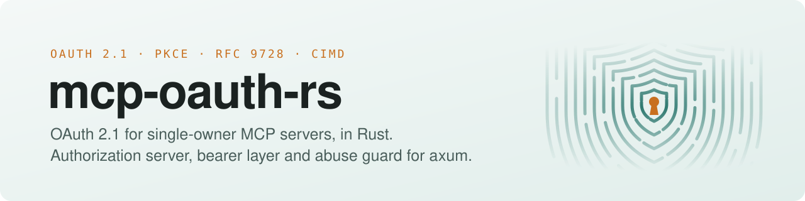

<picture>
  <source media="(prefers-color-scheme: dark)" srcset="banner-dark.svg">
  
</picture>

<p align="center">
  <a href="https://github.com/mcp-oauth-rs/mcp-oauth#quickstart"><b>Quickstart</b></a> ·
  <a href="https://github.com/mcp-oauth-rs/mcp-oauth#features">Features</a> ·
  <a href="https://github.com/mcp-oauth-rs/mcp-oauth#configuration">Docs</a> ·
  <a href="https://github.com/mcp-oauth-rs/mcp-oauth#threat-model">Threat model</a> ·
  <a href="https://github.com/mcp-oauth-rs/mcp-oauth/issues">Issues</a>
</p>

<p align="center">
  <a href="https://github.com/mcp-oauth-rs/mcp-oauth/actions/workflows/ci.yml"></a>
  
  
  
  <a href="https://github.com/mcp-oauth-rs/mcp-oauth/blob/main/LICENSE"></a>
</p>

Your MCP server has one owner: you. **mcp-oauth-server** makes it its own OAuth 2.1 authorization server and protected resource, puts **one owner password** (argon2id) in front of the consent screen, and wraps the whole axum app in an **abuse guard**. It knows nothing about your tools. Verified live with the claude.ai and ChatGPT custom connectors; the Claude Code flow is tested end to end.

| | Project | What it is |
|---|---|---|
| 🛡️ | [**mcp-oauth**](https://github.com/mcp-oauth-rs/mcp-oauth) | The `mcp-oauth-server` crate: authorization server, `bearer_layer()` for the MCP route, and `protect()`, the per-IP rate limit and ban. |

#### What's in it

- **Discovery**: Protected Resource Metadata ([RFC 9728](https://www.rfc-editor.org/rfc/rfc9728)) and Authorization Server Metadata ([RFC 8414](https://www.rfc-editor.org/rfc/rfc8414)).
- **Code flow with PKCE S256 for every client** ([OAuth 2.1](https://datatracker.ietf.org/doc/draft-ietf-oauth-v2-1/), [RFC 7636](https://www.rfc-editor.org/rfc/rfc7636)), tokens bound to the MCP URL ([RFC 8707](https://www.rfc-editor.org/rfc/rfc8707)), `iss` in every response ([RFC 9207](https://www.rfc-editor.org/rfc/rfc9207)).
- **Client ID Metadata Documents** with an optional allowlist and SSRF-hardened fetcher ([draft-ietf-oauth-client-id-metadata-document](https://datatracker.ietf.org/doc/draft-ietf-oauth-client-id-metadata-document/), [MCP authorization](https://modelcontextprotocol.io/specification/2025-11-25/basic/authorization)), `private_key_jwt` with single-use `jti` ([RFC 7523](https://www.rfc-editor.org/rfc/rfc7523)), and Dynamic Client Registration ([RFC 7591](https://www.rfc-editor.org/rfc/rfc7591)).
- **Refresh rotation with reuse detection**, revocation ([RFC 7009](https://www.rfc-editor.org/rfc/rfc7009)), loopback redirects on any port ([RFC 8252 §7.3](https://www.rfc-editor.org/rfc/rfc8252#section-7.3)).
- **Abuse guard**: per-IP token bucket, ban after repeated authentication failures, body, timeout and concurrency caps, at most 2 argon2id checks at once ([RFC 9106](https://www.rfc-editor.org/rfc/rfc9106)), and a shared-IP mode where a ban never cuts a client with valid credentials.
- **Only digests at rest**: SHA-256 of tokens and client secrets, files mode 600.

```toml
[dependencies]
mcp-oauth-server = { git = "https://github.com/mcp-oauth-rs/mcp-oauth" }
```

```rust
let oauth = OAuth::new(config)?; // issuer, MCP path, owner password hash, state dir
let app = Router::new()
    .route("/mcp", any(mcp).layer(oauth.bearer_layer()))
    .merge(oauth.router());
let app = protect(app, Guard::new(Limits::default()));
```

<sub>Found a vulnerability? Please use GitHub's <a href="https://github.com/mcp-oauth-rs/mcp-oauth/security/advisories/new">private vulnerability reporting</a>, not a public issue. MIT licensed. Not affiliated with Anthropic, OpenAI or the Model Context Protocol project.</sub>
